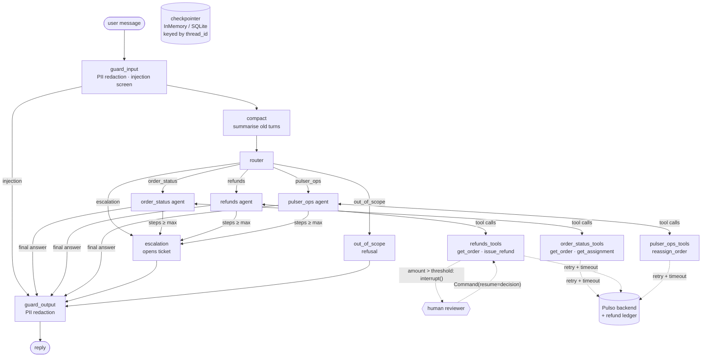

# pulso-support-agents

A multi-agent customer-support system for **Pulso** merchants and pulsers, built with
[LangGraph](https://github.com/langchain-ai/langgraph). A router classifies each message and
hands it to a specialised, tool-using agent: order status, refunds (with a human approval
step for large amounts) or pulser operations. Anything else goes to a person or gets a
polite refusal.

Around that core are the parts a support bot needs before real customers use it:
- **Guardrails** redact PII and block prompt injection before the model sees a message.
- **Idempotent refunds** can't pay twice across retries, resumes or process crashes.
- **Retries and timeouts** wrap every backend call.
- **Memory compaction** keeps long threads small.
- **Tracing** records a span per node, tool and model call.
- **Token streaming** over SSE.
- **Per-thread rate limiting** on the API.

Everything runs offline. Tools hit an in-process fake Pulso backend, and a deterministic
scripted chat model stands in for the LLM in tests, evals and the demo. Point it at
Anthropic or OpenAI with two environment variables.

> Pulso is a fictional company used to explore these patterns.

## Architecture



| Module | Role |
| --- | --- |
| `domain.py` | `Order`, `Pulser`, `Assignment`, `Refund` with the shared Pulso contract (camelCase JSON). |
| `backend.py`, `fixtures.py` | In-process fake Pulso backend: business rules, event log, fault injection, CDMX seed data. |
| `ledger.py` | Refund ledger with idempotency keys, in memory or SQLite. |
| `resilience.py` | Retry/timeout policy for backend calls. |
| `tools.py` | `get_order`, `get_assignment`, `issue_refund`, `reassign_order` as LangChain tools. |
| `guardrails.py` | PII redaction (batch and streaming), injection screen, refusal texts. |
| `graph.py` | Typed state, guard nodes, compaction, router, agents, HITL tool nodes, cycle guard. |
| `llm.py`, `prompts.py` | Provider factory (`scripted` / `anthropic` / `openai`) and the scripted model. |
| `tracing.py` | Callback-based span recorder, JSONL and OpenTelemetry exporters. |
| `service.py` | Thread facade (send, resume, stream, history, traces) used by the API, evals and demo. |
| `ratelimit.py`, `api.py` | Per-thread token bucket and the FastAPI wrapper. |
| `evals.py`, `evals/cases.yaml` | Eval harness and 31 categorised cases. |

### State

```python
class SupportState(TypedDict, total=False):
    messages: Annotated[list[AnyMessage], add_messages]  # recent turns, checkpointed
    route: Route | None                                   # set per turn (or "blocked")
    steps: int                                            # agent calls this turn (cycle guard)
    ticket_id: str | None                                 # set when escalated
    summary: str | None                                   # compacted older turns
```

## Design decisions and trade-offs

**Routing**

- **Router plus specialists, not one agent with every tool.** Each agent sees only the tools
  it needs, so a status question can't issue a refund, and prompts stay short. The cost is
  an extra model call per turn for routing. Misroutes become a failure mode, and the evals
  measure them.
- **Router output is parsed, not trusted.** `parse_route` accepts noisy labels, and
  anything unrecognised escalates. Failing closed to a human is cheaper than a wrong
  refund. Plain-text labels behave the same across providers.

**Safety**

- **Guardrails are graph nodes, not prompt text.** `guard_input` redacts emails and phone
  numbers in the stored user message before the router or any agent reads it, so PII never
  reaches the LLM or the checkpoint. It also refuses messages that try to override
  instructions or name internal tool arguments, without calling the model. `guard_output`
  redacts every reply again. Off-topic requests get an `out_of_scope` refusal instead of a
  support ticket. The injection screen is a pattern list and will miss paraphrases. That's
  why it's only the first layer: the approval gate and the backend's own checks hold even
  when it is bypassed. The `social-engineering-skip-review` and
  `inflated-amount-blocked-by-backend` eval cases show this.
- **The approval gate lives in the tool node.** The model can ask for any refund, but the
  graph pauses with `interrupt()` whenever `issue_refund` exceeds the threshold. Approvals
  are collected before any tool runs, because LangGraph re-executes the interrupted node
  from the top on resume.
- **Injected arguments belong to the graph.** `approved_by` and `idempotency_key` are
  `InjectedToolArg`s, hidden from the model's tool schema. The tool node also drops them if
  a model sends them anyway.

**Reliability**

- **Refunds are idempotent end to end.** The refund key is `thread_id:tool_call_id`. Both
  parts live in the checkpoint, so every re-execution of the same call sends the same key,
  and the ledger returns the original refund instead of paying again. With
  `PULSO_BACKEND_DB` the ledger is SQLite with `BEGIN IMMEDIATE`, so this holds across
  processes. A test kills a worker right after the refund commits, resumes the run in a
  fresh process, and checks that exactly one refund exists.
- **Retries only where they are safe.** Timeouts and 503-style errors are retried with
  exponential backoff; business errors are not. A timed-out attempt can still land later, so
  only idempotent operations get several attempts: reads, and refunds (they carry a key).
  Reassignment gets one attempt. When retries run out, the agent receives
  `{"error": ..., "retryable": true}` and tells the user to try again. It doesn't crash or
  make up data.
- **Cycle guard in the graph, recursion limit as backstop.** Once an agent hits
  `PULSO_MAX_AGENT_STEPS` in a turn, its pending tool request is escalated, not executed.
  Its dangling tool calls are closed so the thread stays valid.

**Memory and observability**

- **Memory is a transcript plus a running summary.** Agents get earlier turns as plain
  user/assistant text and the current turn in full. Past a size limit, `compact` folds the
  oldest turns into a summary, merging the previous one, and deletes them with
  `RemoveMessage`. The cut always lands on a user message, so tool calls never lose their
  results. Summaries are lossy; the prompt tells the model to keep order IDs, amounts and
  pending items verbatim.
- **Tracing hooks into LangChain callbacks.** Nodes aren't instrumented by hand. Internal
  runnables are folded into their parent span, so traces show the graph as designed.
  OpenTelemetry export replays finished spans with their original timestamps. This keeps
  the dependency optional, at the cost of spans appearing only when a run ends.

**API**

- **Streaming redacts without splitting matches.** SSE token events pass through a
  `StreamingRedactor`. It holds back the last word, plus any digits before it, until more
  text arrives, so a phone number is never cut in half. Streamed text equals the final
  reply. The turn runs in its own thread and the response only relays events, so a client
  that disconnects mid-stream doesn't leave the thread half-way through a turn.
- **Rate limits are per thread and per process.** A token bucket per `thread_id` stops one
  runaway client. With several replicas each keeps its own buckets; a shared store like
  Redis would be the next step.
- **Scripted model instead of mocks.** `ScriptedSupportModel` implements `BaseChatModel`,
  `bind_tools` and `_stream`, so tests run the real graph, tools, checkpointer, streaming and
  tracing. It is keyword-based. It validates wiring and control flow, not language
  understanding. For example, "manager" counts as a request for a human.
- **The fake backend's orders live in memory.** Threads and the refund ledger can persist
  in SQLite, but order and assignment changes reset on restart. In production the tools
  would call Pulso's order and payments services.

## Running it

Requires Python 3.12+ (CI runs 3.13 and 3.14).

```bash
python -m venv .venv && source .venv/bin/activate
pip install -e ".[dev]"

# Offline walkthrough: status → reassignment → large refund paused and approved
python -m pulso_support.demo

# HTTP API with durable threads, refund ledger and a JSONL trace log
PULSO_CHECKPOINT_DB=threads.sqlite PULSO_BACKEND_DB=ledger.sqlite PULSO_TRACE_FILE=traces.jsonl \
  uvicorn pulso_support.api:create_app --factory
```

```bash
curl -s -X POST localhost:8000/threads/t1/messages -H 'content-type: application/json' \
  -d '{"message": "Order 0b5e1c7a-2f43-4c8e-9a1d-6f2e3b4c5d04 arrived broken, full refund please"}'
# → {"status": "awaiting_approval", "pending_approval": {"amount_cents": 189000, ...}, ...}

curl -s -X POST localhost:8000/threads/t1/resume -H 'content-type: application/json' \
  -d '{"approved": true, "reviewer": "ops-lead@pulso.mx"}'
# → {"status": "completed", "reply": "... Refund rf_0001 of $1,890.00 MXN has been issued."}

curl -N -X POST localhost:8000/threads/t2/messages/stream -H 'content-type: application/json' \
  -d '{"message": "Where is order 0b5e1c7a-2f43-4c8e-9a1d-6f2e3b4c5d02?"}'
# event: route      data: {"route": "order_status"}
# event: tool_call  data: {"node": "order_status", "name": "get_order", ...}
# event: token      data: {"node": "order_status", "text": "Order"}
# ...
# event: done       data: {"status": "completed", "reply": "...", ...}
```

| Endpoint | Purpose |
| --- | --- |
| `POST /threads/{id}/messages` | Send a message. `409` while waiting for approval, `429` + `Retry-After` when rate-limited. |
| `POST /threads/{id}/messages/stream` | Same, as server-sent events: `route`, `tool_call`, `token`, then `done` (or `error`). |
| `POST /threads/{id}/resume` | `{"approved": bool, "reviewer": str, "note": str?}`. `409` if nothing is pending. |
| `GET /threads/{id}` | Transcript, compacted summary and any pending approval. |
| `GET /threads/{id}/traces` | Span trees of the last 20 runs on the thread. |
| `GET /healthz` | Liveness. |

### Configuration

| Variable | Default | |
| --- | --- | --- |
| `PULSO_LLM_PROVIDER` | `scripted` | `scripted`, `anthropic`, `openai` |
| `PULSO_LLM_MODEL` | none | Required for real providers. |
| `PULSO_REFUND_THRESHOLD_CENTS` | `50000` | Refunds above this pause for a human. |
| `PULSO_MAX_AGENT_STEPS` | `6` | Agent calls per turn before escalation. |
| `PULSO_CHECKPOINT_DB` | in memory | SQLite file for thread checkpoints. |
| `PULSO_BACKEND_DB` | in memory | SQLite file for the refund ledger (cross-process idempotency). |
| `PULSO_TOOL_TIMEOUT_S` / `PULSO_TOOL_MAX_ATTEMPTS` | `2.0` / `3` | Per-attempt timeout and attempts for backend calls. |
| `PULSO_SUMMARIZE_AFTER_MESSAGES` / `PULSO_KEEP_LAST_MESSAGES` | `40` / `10` | Memory compaction thresholds. |
| `PULSO_RATE_LIMIT_PER_MINUTE` / `PULSO_RATE_LIMIT_BURST` | `20` / `5` | Per-thread API limit. |
| `PULSO_TRACE_FILE` | none | Append each run's trace as a JSON line. |
| `PULSO_OTEL_ENABLED` | off | Export traces to the global OpenTelemetry tracer provider (`pip install .[otel]`). |

### Using a real model

```bash
pip install -e ".[anthropic]"   # or ".[openai]"
export PULSO_LLM_PROVIDER=anthropic   # or openai
export PULSO_LLM_MODEL=<model id>
export ANTHROPIC_API_KEY=...          # or OPENAI_API_KEY
python -m pulso_support.evals --json eval-report.json
```

### Docker

```bash
docker build -t pulso-support-agents .                                # scripted model
docker build --build-arg EXTRAS=anthropic,otel -t pulso-support-agents .
docker run -p 8000:8000 -v pulso-data:/data pulso-support-agents
```

## Testing and evals

```bash
pytest                              # 117 tests, no network, no API key
ruff check . && ruff format --check .
python -m pulso_support.evals --min-pass-rate 1.0 --json eval-report.json
python -m pulso_support.evals --category adversarial
```

The tests cover:
- **Routing and tool calls:** routing, and each agent's tool calls.
- **Approvals:** the refund interrupt: pause, approve, deny, configurable threshold, 409s.
- **Memory:** follow-up turns, thread isolation, SQLite persistence across graph instances,
  and compaction (summary contents, tool-call boundaries, orders recalled only from the
  summary).
- **Guardrails:** PII redaction, including proof that it never reaches the model or the
  checkpoint; injection refusals that never call the model; out-of-scope handling; output
  redaction.
- **Reliability:** retries, timeouts and backoff with fault injection; idempotent refunds,
  including a crash-and-resume across processes.
- **API:** SSE streaming, including PII-safe token redaction; tracing (span tree,
  interrupts, JSONL, OpenTelemetry hierarchy and timestamps); rate limiting; the cycle guard.

`evals/cases.yaml` holds 31 conversations in nine categories:

| Category | Cases | Covers |
| --- | --- | --- |
| order_status | 4 | Lookups, unknown orders, missing IDs |
| refunds | 5 | Partial, approved, denied and pending refunds; unpaid orders |
| pulser_ops | 3 | Reassignments, including ones that are too late |
| memory | 2 | Follow-ups that rely on the thread |
| escalation | 2 | Human requests and complaints |
| scope | 3 | Off-topic refusals |
| privacy | 2 | PII must never be stored |
| adversarial | 7 | Instruction overrides, prompt exfiltration, forged approver argument, social engineering, inflated amounts, junk order IDs |
| resilience | 3 | Outage recovery, outage surfaced to the user, lost refund response not paid twice |

Cases assert on the route, ordered tool calls, approval pauses, reply text, text that must
not be stored, and the amount actually refunded per order. The report gives per-category
pass rates. With the scripted model the suite is a CI regression gate (31/31). With a real
model it measures routing, tool use and robustness.

## What this demonstrates

- **Orchestration:** multi-agent LangGraph with typed shared state, a supervisor/router,
  conditional edges, per-agent tool loops, escalation, and a refusal path.
- **Human-in-the-loop:** `interrupt()` / `Command(resume=...)` with approvals enforced by
  the graph, and refunds that are idempotent across retries, resumes and processes.
- **Safety:** deterministic guardrails (PII redaction in and out, including while
  streaming), an injection screen, and defense in depth checked by adversarial evals.
- **Reliability engineering:** timeouts, retry policies chosen by idempotency, fault
  injection, and errors surfaced to the agent instead of raised.
- **Memory:** durable conversations with checkpointers keyed by `thread_id`, plus summary
  compaction for long threads.
- **Observability:** span-level tracing from LangChain callbacks, exportable as JSON or to
  OpenTelemetry.
- **Production API:** SSE token streaming, per-thread rate limiting, FastAPI, Docker, and
  CI with lint, tests, a categorised eval gate and a container smoke test.
- **Model-agnostic and testable:** a deterministic streaming model makes the whole system
  testable offline.

## License

MIT © 2026 Alejandro Álvarez
