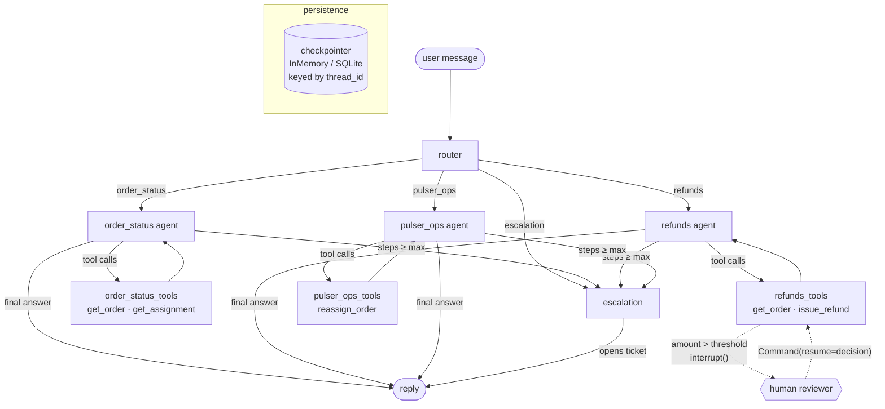

# pulso-support-agents

A multi-agent customer-support system for **Pulso** merchants and pulsers, built with
[LangGraph](https://github.com/langchain-ai/langgraph). A router classifies each message and
hands it to a specialised, tool-using agent: order status, refunds (with a human approval
step for large amounts) or pulser operations. Anything else is escalated to a person.
Conversations are durable: every thread is checkpointed, so follow-up questions keep their
context and a refund waiting for approval survives a restart.

Everything runs offline. Tools hit an in-process fake Pulso backend, and a deterministic
scripted chat model stands in for the LLM in tests, evals and the demo. Point it at
Anthropic or OpenAI with two environment variables.

> Pulso is a fictional company used to explore these patterns.

## Architecture



| Module | Role |
| --- | --- |
| `domain.py` | `Order`, `Pulser`, `Assignment`, `Refund` with the shared Pulso contract (camelCase JSON). |
| `backend.py`, `fixtures.py` | In-process fake Pulso backend: business rules, event log, seed data in CDMX. |
| `tools.py` | `get_order`, `get_assignment`, `issue_refund`, `reassign_order` as LangChain tools. |
| `graph.py` | Typed state, router, agents, tool nodes with the HITL interrupt, cycle guard, escalation. |
| `llm.py`, `prompts.py` | Provider factory (`scripted` / `anthropic` / `openai`) and the scripted model. |
| `service.py` | Thread facade used by the API, evals and demo; checkpointer selection. |
| `api.py` | FastAPI wrapper. |
| `evals.py`, `evals/cases.yaml` | Eval harness and cases. |

### State

```python
class SupportState(TypedDict, total=False):
    messages: Annotated[list[AnyMessage], add_messages]  # whole thread, checkpointed
    route: Route                                          # set by the router each turn
    steps: int                                            # agent calls this turn (cycle guard)
    ticket_id: str | None                                 # set when escalated
```

## Design decisions and trade-offs

- **Router + specialists rather than one agent with every tool.** Each agent sees only the
  tools it needs, so a status question cannot issue a refund, and prompts stay short. The
  cost is one extra model call per turn for routing, and misroutes become a failure mode;
  the eval suite measures that.
- **Router output is parsed, not trusted.** The router answers with a label; `parse_route`
  accepts noisy variants (`` `refunds` ``, `Pulser_Ops.`) and anything unrecognised goes to
  escalation. Failing closed to a human is cheaper than a wrong refund. Structured output
  would be stricter, but plain-text labels work identically across providers.
- **The approval gate lives in the tool node, not in the prompt.** The model can ask for any
  refund; the graph pauses with `interrupt()` whenever `issue_refund` exceeds
  `PULSO_REFUND_THRESHOLD_CENTS` (default 500 MXN). All approvals are collected before any
  tool runs, because LangGraph re-executes the interrupted node from the top on resume. That
  ordering is what makes "approve once, refund once" hold. The reviewer's identity reaches the
  backend through an `InjectedToolArg`, so it is recorded on the refund but invisible to (and
  unforgeable by) the model.
- **Cycle guard in the graph, recursion limit as backstop.** Each agent call increments
  `steps`; once it hits `PULSO_MAX_AGENT_STEPS`, a pending tool request is routed to
  escalation instead of executed, and the dangling tool calls are closed with synthetic
  `ToolMessage`s so the thread remains valid for the next turn. LangGraph's
  `recursion_limit` sits above it in case of a bug in the guard itself.
- **Memory is the transcript; tool traces are per turn.** The checkpointer stores the full
  thread, but each agent gets prior turns as plain user/assistant text plus the current
  turn in full. That keeps "and can I get a refund for it?" working across agents without
  sending another agent's tool calls to a provider that never declared those tools.
- **Business errors are data.** Tools return `{"error": ...}` instead of raising, so the agent
  explains "nothing has been charged yet" rather than the graph crashing.
- **Scripted model instead of mocks.** `ScriptedSupportModel` implements `BaseChatModel` and
  `bind_tools`, so tests run the real graph, real tool nodes and real checkpointer. It is
  keyword-based and only as smart as its rules; it validates wiring and control flow, not
  language understanding.
- **Fake backend is in memory.** Thread state persists in SQLite, but the fake backend's
  refunds and assignments reset when the process restarts. In production the tools would call
  Pulso's order and payments services.

## Running it

Requires Python 3.12+ (CI runs 3.13 and 3.14).

```bash
python -m venv .venv && source .venv/bin/activate
pip install -e ".[dev]"

# Offline walkthrough: status → reassignment → large refund paused and approved
python -m pulso_support.demo

# HTTP API (threads persist in SQLite if PULSO_CHECKPOINT_DB is set)
PULSO_CHECKPOINT_DB=threads.sqlite uvicorn pulso_support.api:create_app --factory
```

```bash
curl -s -X POST localhost:8000/threads/t1/messages -H 'content-type: application/json' \
  -d '{"message": "Order 0b5e1c7a-2f43-4c8e-9a1d-6f2e3b4c5d04 arrived broken, full refund please"}'
# → {"status": "awaiting_approval", "pending_approval": {"amount_cents": 189000, ...}, ...}

curl -s -X POST localhost:8000/threads/t1/resume -H 'content-type: application/json' \
  -d '{"approved": true, "reviewer": "ops-lead@pulso.mx"}'
# → {"status": "completed", "reply": "... Refund rf_0001 of $1,890.00 MXN has been issued."}
```

| Endpoint | Purpose |
| --- | --- |
| `POST /threads/{id}/messages` | Send a user message. `409` if the thread is waiting for approval. |
| `POST /threads/{id}/resume` | `{"approved": bool, "reviewer": str, "note": str?}`. `409` if nothing is pending. |
| `GET /threads/{id}` | Transcript and any pending approval. |
| `GET /healthz` | Liveness. |

### Using a real model

```bash
pip install -e ".[anthropic]"   # or ".[openai]"
export PULSO_LLM_PROVIDER=anthropic   # or openai
export PULSO_LLM_MODEL=<model id>
export ANTHROPIC_API_KEY=...          # or OPENAI_API_KEY
python -m pulso_support.evals
```

| Variable | Default | |
| --- | --- | --- |
| `PULSO_LLM_PROVIDER` | `scripted` | `scripted`, `anthropic`, `openai` |
| `PULSO_LLM_MODEL` | none | Required for real providers. |
| `PULSO_REFUND_THRESHOLD_CENTS` | `50000` | Refunds above this pause for a human. |
| `PULSO_MAX_AGENT_STEPS` | `6` | Agent calls per turn before escalation. |
| `PULSO_CHECKPOINT_DB` | none (in memory) | SQLite file for thread checkpoints. |

### Docker

```bash
docker build -t pulso-support-agents .                         # scripted model
docker build --build-arg EXTRAS=anthropic -t pulso-support-agents .
docker run -p 8000:8000 -v pulso-data:/data pulso-support-agents
```

## Testing and evals

```bash
pytest                              # 51 tests, no network, no API key
ruff check . && ruff format --check .
python -m pulso_support.evals --min-pass-rate 1.0 --json eval-report.json
```

The tests cover routing (including tolerant parsing of router output), each agent's tool
calls, the refund interrupt (pause, approve, deny, configurable threshold, 409s), memory
across turns, thread isolation, a SQLite checkpoint resumed by a brand-new graph instance,
and the cycle guard with a model that never stops calling tools.

`evals/cases.yaml` holds 14 conversations with the expected route, ordered tool calls,
whether the run should pause for approval and a reply fragment. The harness runs against
whichever provider is configured: with the scripted model it is a regression gate in CI
(14/14), with a real model it measures routing and tool-use quality.

## What this demonstrates

- Multi-agent orchestration in LangGraph: typed shared state, a supervisor/router, conditional
  edges, per-agent tool loops and an explicit escalation path.
- Human-in-the-loop with `interrupt()` / `Command(resume=...)`, written so resumes are
  idempotent and approvals are enforced by the graph rather than the prompt.
- Durable conversational memory with checkpointers keyed by `thread_id`, including
  resuming a paused run after a restart.
- Guardrails for agent loops: step budgets, closing dangling tool calls, fail-closed routing.
- Model-agnostic design over LangChain's chat-model interface, with a deterministic model
  that makes the full graph testable offline.
- An eval harness that turns agent behaviour into a pass rate that can gate CI.
- Packaging for production: FastAPI service, Docker image with a persistent volume, CI with
  lint, tests, evals and a container smoke test.

## License

MIT © 2026 Alejandro Álvarez
